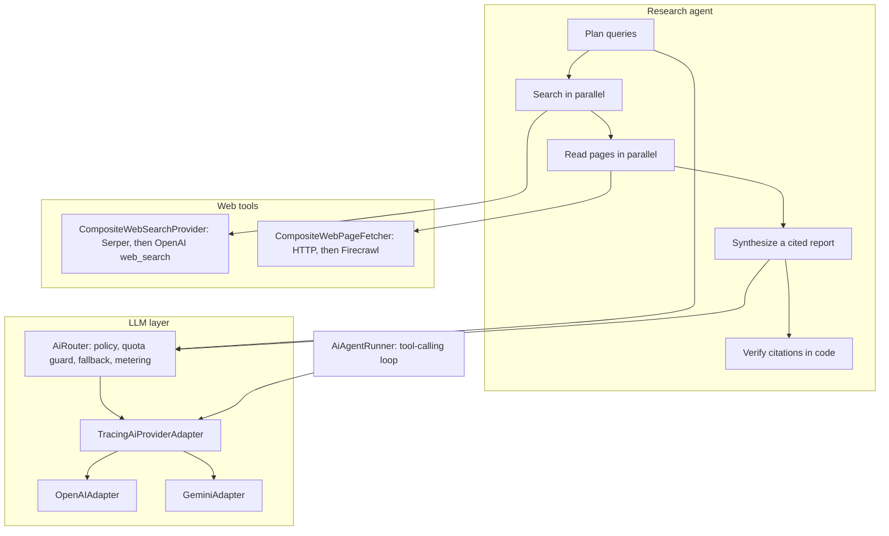

# dotnet-research-agent

An evidence-first **deep research agent** for .NET, on top of a **provider-agnostic LLM layer**.

Give it a company or a topic. It plans a few searches, runs them in parallel, reads the pages, and writes a short report in which every finding cites its sources. Then code — not the model — checks the report: a finding that cites a source the model never saw is dropped, and a finding whose sources do not contain its key terms is flagged as unverified.

The LLM layer underneath was extracted from [Vitena](https://vitena.care), where it serves 20+ LLM task types in production. The git history of that layer comes with it.

Example (shortened, with placeholder sources):

```text
$ dotnet run --project samples/ResearchCli -- "Acme Robotics, Madrid" --focus "products and funding"

# Research: Acme Robotics, Madrid

Acme Robotics is a Madrid company that builds warehouse robots ...

## Findings

- Acme Robotics was founded in 2019 in Madrid. [1]
- It raised 12 million euros in a Series A round. [2][4]

## Sources

1. [About Acme](https://acme.example/about)
2. [Acme raises Series A](https://news.example/acme-raises)
```

## Architecture



Four layers, each behind an interface so any part can be swapped:

| Layer | What it does | Extension point |
|---|---|---|
| **LLM** | One `IAiCompletionService` for the whole app. Each task type has a policy (models, output limit, reasoning effort, provider order). The router falls back to the next provider when one fails, keeps images away from providers that cannot read them, and meters every call. | `IAiProviderAdapter` (add a provider), `IAiUsageMeter` (quota and billing), `IAiTraceRecorder` (where traces go) |
| **Agents** | `AiAgentRunner` runs the tool-calling loop: the model calls tools, sees their results, and continues until it answers or hits the iteration limit. Supports hand-off tools that end the loop, and OpenAI Responses API chaining. | your tools are a `dispatch` function |
| **Web** | Search (Serper first, OpenAI `web_search` as a slow escalation) and page reading (plain HTTP with SSRF guards, Firecrawl for pages that need a browser). | `IWebSearchProvider`, `IWebPageFetcher` |
| **Research** | `DeepResearchAgent`: plan → search → read → synthesize → verify. | `IDeepResearchAgent` |

### Design choices

- **Identity never enters the prompt.** Who is calling comes from `AiTraceContext`, which the host fills from its session. Traces get identity as separate columns; the model only ever sees the task.
- **Every provider call is traced as it really happened:** exact prompts, response, tokens (including cached input), real cost and latency — also for failed fallback attempts. Tasks that carry personal text can turn content tracing off per policy.
- **Fallback is per task policy,** so a cheap model can serve one task and a stronger one another, with a different backup for each.
- **Code gathers evidence, the model synthesizes.** Research is deterministic until the single synthesis call, which makes it cheaper, faster and easier to evaluate than letting the model browse freely.

## Quick start

```bash
export OPENAI_API_KEY=...      # or GEMINI_API_KEY; at least one model provider
export SERPER_API_KEY=...      # web search (serper.dev)
export FIRECRAWL_API_KEY=...   # optional: pages that need a real browser

dotnet run --project samples/ResearchCli -- "Acme Robotics, Madrid" --focus "products and funding" --country es
```

In your own app:

```csharp
builder.Services.AddResearchAgent(builder.Configuration);

// later
var report = await researchAgent.ResearchAsync(new ResearchRequest("Acme Robotics", Focus: "funding"));
Console.WriteLine(report.ToMarkdown());
```

Policies come from configuration:

```json
{
  "Ai": {
    "OpenAI": { "Model": "gpt-6-luna" },
    "Policies": {
      "research.plan":       { "Providers": [ "OpenAI", "Gemini" ], "MaxOutputTokens": 800 },
      "research.synthesize": { "Providers": [ "OpenAI" ], "Model": "gpt-6.1-terra", "MaxOutputTokens": 4000 }
    }
  }
}
```

## Scope

The agent is built for companies, products and topics. It is not meant for profiling private individuals, it skips sites that require a login, and it reads only public pages.

## Tests

```bash
dotnet test
```

The tests run without network access: providers, search and page reading are faked.

## License

MIT
